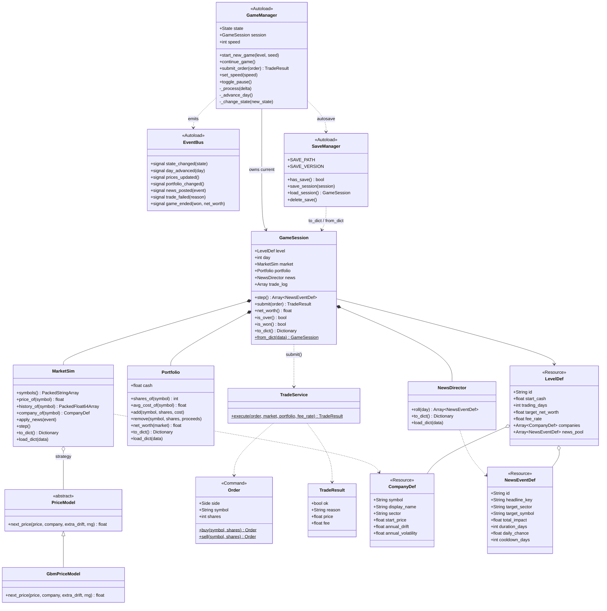
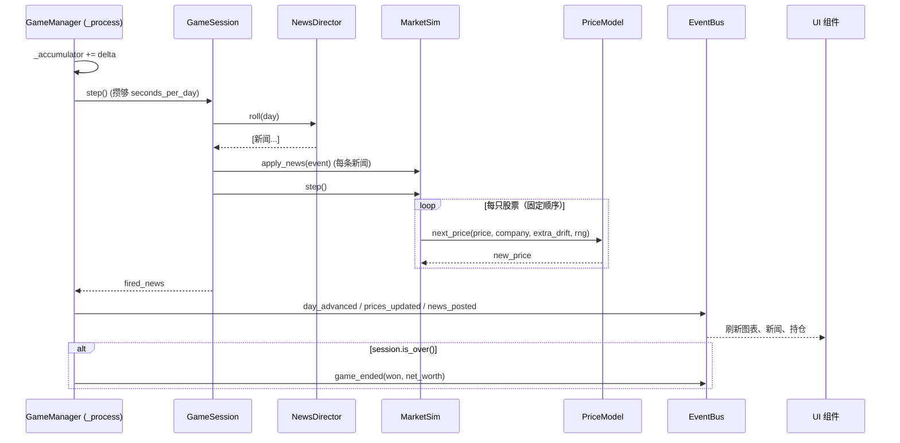
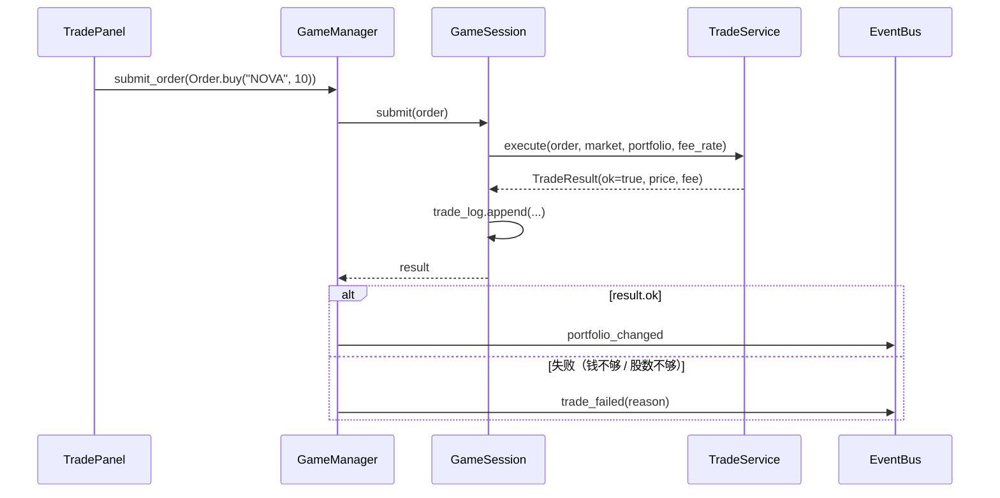
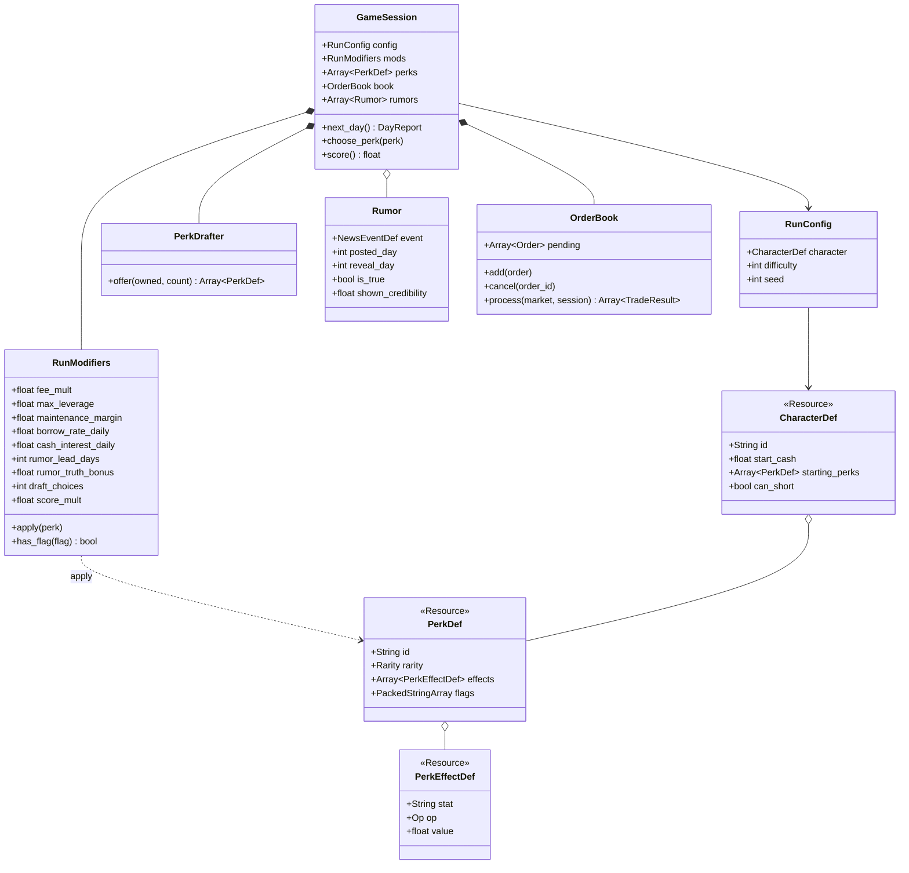

# Stock Simulator — 详细实现计划（Godot 4.7，GDScript）

> 版本：v0.1（2026-11-11）
> 目标：用**最少的代码**做出一个能在 Steam 上发售的单机股票模拟游戏，
> 遵循 Godot 社区规范和常见游戏开发设计模式，并给以后扩展留好接口。
> 总体规划（引擎选择、角色、预算）见 [plan.md](plan.md)。
>
> **⚠️ 修订（2026-11-11）**：20 个设计问题回答后，游戏改为**回合制 Roguelike、先只做网页版、只做英文、本地最高分**。
> 设计决策见 [game-design.md](game-design.md)；**第 13 节**列出了对第 1–12 节的全部修改，
> 冲突时以第 13 节为准（例如实时时钟、速度档位、暂停状态、中文字体、Steam 接入都已移除或推迟）。

---

## 目录

1. [游戏最小可玩版本（MVP）范围](#1-游戏最小可玩版本mvp范围)
2. [架构评分与迭代：从 3/5 到 5/5](#2-架构评分与迭代从-35-到-55)
3. [最终架构总览](#3-最终架构总览)
4. [UML 图](#4-uml-图)
5. [使用的设计模式](#5-使用的设计模式)
6. [项目目录结构（社区规范）](#6-项目目录结构社区规范)
7. [每个组件详细说明 + 代码骨架](#7-每个组件详细说明--代码骨架)
8. [编码规范](#8-编码规范)
9. [本地安装、运行、测试、打包](#9-本地安装运行测试打包)
10. [开发里程碑与验收标准](#10-开发里程碑与验收标准)
11. [以后的扩展点](#11-以后的扩展点)
12. [风险与对策](#12-风险与对策)

---

## 1. 游戏最小可玩版本（MVP）范围

**一句话玩法**：你有 10,000 元起始资金，在 120 个交易日里买卖 5 家虚构公司的股票，
随机新闻会让某个行业大涨或大跌；到期时净资产达到目标就算过关。

| 做 | 不做（以后扩展） |
|---|---|
| 1 个关卡、5 家虚构公司、3 个行业 | 多关卡、剧情 |
| 市价单买入 / 卖出、固定手续费率 | 限价单、做空、杠杆、期权 |
| 每天按概率触发新闻，影响一个行业或一家公司 | 财报季、宏观经济周期 |
| 折线价格图（自己画） | K 线、技术指标 |
| 暂停 / 1× / 2× / 4× 速度 | 回放、撤销 |
| 单个存档槽、自动存档 | 多存档槽、Steam 云存档 |
| 中文 + 英文 | 更多语言 |
| macOS / Windows / Linux 导出 | Steam 成就、排行榜（M6 再接） |

---

## 2. 架构评分与迭代：从 3/5 到 5/5

### 评分标准（每项 0–1 分，满分 6 分，换算成星级）

| # | 标准 | 说明 |
|---|---|---|
| S1 | 简单 | 文件、单例、概念最少；新手能读懂 |
| S2 | 可测试 | 核心规则不依赖场景树，`godot --headless` 能直接测试 |
| S3 | 确定性 | 同一个种子 → 同一局行情，bug 能复现，可做每日挑战 |
| S4 | 数据驱动 | 加公司、新闻、关卡不用改代码 |
| S5 | 可扩展 | 新功能是“加一个类 / 加一个文件”，不是“改一大片” |
| S6 | 符合社区规范 | Godot 官方风格指南、目录结构、静态类型、GUT 测试 |

星级换算：6 分 = ★★★★★，5 分 = ★★★★☆，4 分 = ★★★☆☆，3 分及以下 = ★★☆☆☆。

### 第 1 版：上一轮对话里的五层架构 → ★★★☆☆（4/6）

```
UI ─► 5 个 Autoload（GameClock, MarketService, Portfolio, EventDirector, GoalTracker）
     ─► 模拟层 ─► 数据层 ─► 平台层（SaveSystem, Settings, SteamBridge）
```

| 标准 | 得分 | 问题 |
|---|---|---|
| S1 简单 | 0 | Autoload 太多（8 个），全局状态互相引用，新手难追踪 |
| S2 可测试 | 0 | Portfolio、MarketService 都是 Autoload，测试要启动整个场景树，“重开一局”还要手动清空每个单例 |
| S3 确定性 | 1 | 有种子，但时间用 `_process(delta)` 的浮点数推进，帧率不同结果可能不同 |
| S4 数据驱动 | 1 | 用 `.tres` |
| S5 可扩展 | 1 | 分层清楚 |
| S6 社区规范 | 1 | 基本符合 |

### 第 2 版：把“一局游戏”收进一个纯逻辑对象 → ★★★★☆（5/6）

改动：
- 新增 **`GameSession`**（`RefCounted`，不是节点）：持有市场、持仓、新闻、天数。**重开一局 = new 一个新的 session**。
- Autoload 减到 3 个：`EventBus`、`GameManager`、`SaveManager`。
- 时间改成**固定步长**：`GameManager` 用累加器，每攒够 `seconds_per_day` 秒就调用一次 `session.step()`，规则层只认“第几天”，不认帧率。

| 标准 | 得分 | 剩下的问题 |
|---|---|---|
| S1 | 1 | — |
| S2 | 1 | — |
| S3 | 1 | — |
| S4 | 1 | — |
| S5 | 0 | 价格公式写死在市场里，想换模型要改核心代码；交易直接改持仓，没有统一入口，以后加限价单、交易记录、回放都要改多处 |
| S6 | 1 | — |

### 第 3 版（最终版）：补上三个小接口 → ★★★★★（6/6）

改动（每个都只多一个很小的类）：
1. **策略模式 `PriceModel`**：市场只调用 `model.next_price(...)`，以后换模型（加大盘因子、均值回归）只需新增一个子类。
2. **命令模式 `Order` + `TradeService`**：所有交易都是一个 `Order` 对象，经过唯一入口 `GameSession.submit()` 执行，并写入交易日志。限价单、回放、教程里的“演示下单”都能复用。
3. **备忘录模式 `to_dict()` / `from_dict()`**：每个状态类自己负责序列化，存档文件带 `version` 字段，方便以后迁移旧存档。

| 标准 | 得分 | 依据 |
|---|---|---|
| S1 简单 | 1 | 3 个 Autoload、约 20 个脚本，MVP 代码量约 1,500 行 |
| S2 可测试 | 1 | `core/` 全是 `RefCounted`，GUT 测试不需要场景 |
| S3 确定性 | 1 | 固定步长 + 单个种子随机数生成器 + 固定遍历顺序 + 存档保存随机数状态 |
| S4 数据驱动 | 1 | 公司 / 新闻 / 关卡都是 `Resource` |
| S5 可扩展 | 1 | 策略、命令、事件总线、平台适配，四个扩展口 |
| S6 社区规范 | 1 | 官方 GDScript 风格指南、按功能分目录、静态类型、`##` 文档注释、GUT、gdtoolkit |

**为什么不再加更多东西**：ECS、依赖注入容器、状态机框架、MVVM 对这个规模都是过度设计，会违反 S1。

---

## 3. 最终架构总览

```
┌──────────────────────────────────────────────────────────────────────┐
│ ui/        表现层（场景 .tscn + 脚本），只负责“显示”和“把操作转发”        │
│   MainMenu   GameScreen[ TopBar · PriceChart · TradePanel ·             │
│                           PortfolioView · NewsFeed ]   GameOverDialog   │
└───────────┬──────────────────────────────────────────▲───────────────┘
            │ 调用 GameManager.submit_order(Order)        │ 监听 EventBus 信号
┌───────────▼──────────────────────────────────────────┴───────────────┐
│ autoload/  全局服务（只有 3 个）                                        │
│   EventBus     信号中转站（观察者模式）                                 │
│   GameManager  游戏状态机 + 固定步长时钟，持有当前 GameSession          │
│   SaveManager  存档读写（JSON，带版本号）                               │
└───────────┬──────────────────────────────────────────────────────────┘
            │ session.step() / session.submit(order)
┌───────────▼──────────────────────────────────────────────────────────┐
│ core/      纯规则层（RefCounted，不依赖节点，可单独测试）                │
│   GameSession ──┬── MarketSim ── PriceModel ◁── GbmPriceModel           │
│                 ├── Portfolio                                           │
│                 ├── NewsDirector                                        │
│                 └── TradeService（执行 Order → TradeResult）            │
└───────────┬──────────────────────────────────────────────────────────┘
            │ 读取
┌───────────▼──────────────────────────────────────────────────────────┐
│ data/      内容（Resource .tres）                                       │
│   CompanyDef × 5    NewsEventDef × 12    LevelDef × 1                   │
└──────────────────────────────────────────────────────────────────────┘
```

**依赖方向规则（必须遵守）**：
- `ui → autoload → core → data`，只能往下依赖。
- `core/` **不能**引用任何 Autoload、节点或 UI，否则就测试不了了。
- `ui/` **不能**直接改 `core/` 里的状态，只能通过 `GameManager` 提交命令。
- 往上的通知**只走** `EventBus` 信号。

---

## 4. UML 图

### 4.1 类图（Mermaid，GitHub 和 VS Code 能直接渲染）



### 4.2 类图（ASCII，终端里也能看）

```
               «Autoload»                 «Autoload»            «Autoload»
             ┌────────────┐  emits     ┌──────────────┐  save  ┌─────────────┐
   UI ──────►│GameManager │───────────►│  EventBus    │◄───────│ SaveManager │
  submit     │ state: FSM │            │ (signals)    │        │ JSON + ver  │
  _order()   │ session ◆──┼──┐         └──────▲───────┘        └──────┬──────┘
             └────────────┘  │                │ connect               │to/from_dict
                             ▼                │                       ▼
                     ┌────────────────┐   UI 组件监听            ┌──────────┐
                     │  GameSession   │◄─────────────────────────┤ (同左)   │
                     │ day, level     │                          └──────────┘
                     │ step()         │
                     │ submit(Order)  │──uses──► TradeService ──► TradeResult
                     └─┬─────┬─────┬──┘              ▲
                       ◆     ◆     ◆                 │ «Command»
              ┌────────┘     │     └───────┐       Order{side,symbol,shares}
              ▼              ▼             ▼
        ┌──────────┐  ┌───────────┐  ┌──────────────┐
        │MarketSim │  │ Portfolio │  │ NewsDirector │
        │ stocks{} │  │ cash      │  │ cooldowns{}  │
        └────┬─────┘  │ positions │  └──────┬───────┘
             │ ◇      └───────────┘         │ reads
             ▼                              ▼
     «Strategy» PriceModel          NewsEventDef «Resource»
             △
             │
       GbmPriceModel                LevelDef ◇── CompanyDef «Resource»

  图例：◆ 组合（同生共死）  ◇ 聚合/引用   △ 继承   ──► 依赖/调用
```

### 4.3 时序图：一个交易日的推进



### 4.4 时序图：玩家买入



### 4.5 游戏状态机

```
              start_new_game() / continue_game()
   ┌──────┐ ─────────────────────────────────────► ┌─────────┐
   │ MENU │                                        │ PLAYING │◄──┐
   └──────┘ ◄──────────── 回到主菜单 ─────────────  └────┬────┘   │ toggle_pause()
      ▲                                                 │        │
      │ 回到主菜单                       toggle_pause() │   ┌────┴───┐
      │                                                 └──►│ PAUSED │
   ┌──┴────────┐      session.is_over()                     └────────┘
   │ GAME_OVER │◄──────────────────────── PLAYING
   └───────────┘
```

---

## 5. 使用的设计模式

| 模式 | 出处（《游戏编程模式》等） | 在本项目的位置 | 解决什么问题 |
|---|---|---|---|
| **游戏循环 + 固定步长** | Game Loop | `GameManager._process` 累加器 | 帧率不同，游戏速度和结果也一致 |
| **单例（Godot 的 Autoload）** | Singleton / Service | `EventBus`、`GameManager`、`SaveManager` | 全局只有一份的服务；**数量控制在 3 个** |
| **观察者（信号）** | Observer | `EventBus` + 各 UI 组件 | UI 和逻辑互相不知道对方，改 UI 不会弄坏逻辑 |
| **状态机** | State | `GameManager.State` 枚举 | 明确每个状态下能做什么，避免暂停时还能下单之类的 bug |
| **命令** | Command | `Order` + `TradeService` | 交易统一入口，可记录、可回放、以后可做限价单 |
| **策略** | Strategy | `PriceModel` / `GbmPriceModel` | 换价格模型不用改市场代码 |
| **类型对象 / 数据驱动** | Type Object | `CompanyDef`、`NewsEventDef`、`LevelDef` | 内容和代码分离，Claude 可以批量生成 `.tres` |
| **备忘录** | Memento | `to_dict()` / `from_dict()` | 存档读档、存档版本迁移 |
| **组合优于继承** | Component（Godot 场景组合） | `GameScreen` 由 5 个子场景组成 | 每个 UI 组件可以单独打开、单独测试 |
| **模型–视图分离** | Model-View | `core/` 和 `ui/` | 同一套规则以后可以换皮、做网页 Demo |

---

## 6. 项目目录结构（社区规范）

Godot 官方建议：**按功能分目录**、文件和目录名用 `snake_case`、类名用 `PascalCase`、场景和它的脚本放在一起。

```
stock-simulator/
├── project.godot                 # 项目配置（Autoload、输入映射、窗口设置）
├── icon.svg
├── export_presets.cfg            # 导出配置（不含密钥，提交到 git）
├── .gitignore  .gitattributes  .editorconfig
├── README.md
├── docs/
│   ├── plan.md
│   └── implementation-plan.md    # 本文件
├── addons/
│   └── gut/                      # 测试框架 GUT（从 AssetLib 安装）
├── autoload/
│   ├── event_bus.gd
│   ├── game_manager.gd
│   └── save_manager.gd
├── core/                         # 纯逻辑，禁止引用节点 / Autoload
│   ├── game_session.gd
│   ├── market/
│   │   ├── market_sim.gd
│   │   ├── price_model.gd
│   │   └── gbm_price_model.gd
│   ├── portfolio/
│   │   └── portfolio.gd
│   ├── news/
│   │   └── news_director.gd
│   └── trading/
│       ├── order.gd
│       ├── trade_result.gd
│       └── trade_service.gd
├── data/
│   ├── defs/                     # Resource 类定义（脚本）
│   │   ├── company_def.gd
│   │   ├── news_event_def.gd
│   │   └── level_def.gd
│   ├── companies/                # 内容（.tres）
│   │   ├── nova.tres  helix.tres  ...
│   ├── news/
│   │   ├── tech_breakthrough.tres  ...
│   └── levels/
│       └── level_01.tres
├── ui/
│   ├── theme/
│   │   └── main_theme.tres
│   ├── main_menu/
│   │   ├── main_menu.tscn
│   │   └── main_menu.gd
│   ├── game_screen/
│   │   ├── game_screen.tscn
│   │   ├── game_screen.gd
│   │   ├── top_bar.tscn / .gd
│   │   ├── price_chart.gd        # 自定义 Control，_draw() 画折线
│   │   ├── trade_panel.tscn / .gd
│   │   ├── portfolio_view.tscn / .gd
│   │   └── news_feed.tscn / .gd
│   └── game_over/
│       ├── game_over_dialog.tscn
│       └── game_over_dialog.gd
├── localization/
│   └── strings.csv               # key,en,zh_CN
├── audio/                        # 音效（M4 再加）
├── tests/
│   └── unit/
│       ├── test_price_model.gd
│       ├── test_portfolio.gd
│       ├── test_trade_service.gd
│       ├── test_game_session.gd
│       └── test_save_roundtrip.gd
└── tools/
    └── balance_sim.gd            # 命令行平衡工具（extends SceneTree）
```

---

## 7. 每个组件详细说明 + 代码骨架

> 下面的代码是**骨架**：结构、接口、关键逻辑都写好了，细节由 Claude Code 在实现时补全并跑测试验证。
> 缩进按官方规范用 **Tab**。`##` 是 Godot 的文档注释，会显示在编辑器的帮助里。
> 这台电脑上还没装 Godot，这些代码还没在 4.7.2 上编译过，M1 时第一时间验证。

### 7.1 data/ — 内容定义（类型对象模式）

#### CompanyDef — 一家虚构公司

**作用**：描述一只股票的“出厂设置”。不保存运行时价格（价格在 `MarketSim` 里）。
**谁用**：`MarketSim` 初始化时读取；UI 显示公司名、行业。

```gdscript
# data/defs/company_def.gd
## 一家虚构上市公司的静态数据。运行时状态（当前价格）不放在这里。
class_name CompanyDef
extends Resource

## 股票代码，全局唯一，例如 "NOVA"。存档和交易都用它做 key。
@export var symbol: String = ""
## 显示名称的本地化 key，例如 "COMPANY_NOVA"。
@export var display_name: String = ""
## 行业，用于新闻按行业影响，例如 "tech" / "energy" / "consumer"。
@export var sector: String = ""
## 开局价格。
@export_range(1.0, 10000.0) var start_price: float = 50.0
## 年化漂移率（长期趋势）。0.08 表示一年平均涨 8%。
@export_range(-0.5, 0.5) var annual_drift: float = 0.06
## 年化波动率。0.2 是稳健股，0.6 是妖股。
@export_range(0.01, 2.0) var annual_volatility: float = 0.3
```

#### NewsEventDef — 一条新闻模板

**作用**：描述“什么时候可能发生、影响谁、影响多大、持续多久”。
**谁用**：`NewsDirector` 每天掷骰决定是否触发；`MarketSim` 把它转成价格冲击；`NewsFeed` 显示标题。

```gdscript
# data/defs/news_event_def.gd
## 一条随机新闻的模板。触发后在 duration_days 天内把 total_impact 分摊到每日价格。
class_name NewsEventDef
extends Resource

@export var id: String = ""
## 标题的本地化 key。
@export var headline_key: String = ""
## 影响的行业；"" 表示不按行业，"all" 表示全市场。
@export var target_sector: String = ""
## 影响的单只股票代码；不为空时优先于 target_sector。
@export var target_symbol: String = ""
## 总影响幅度。+0.20 表示累计约 +20%，-0.15 表示累计约 -15%。
@export_range(-0.9, 2.0) var total_impact: float = 0.1
## 影响分摊到几天。
@export_range(1, 60) var duration_days: int = 5
## 每天触发的概率（0~1）。
@export_range(0.0, 1.0) var daily_chance: float = 0.03
## 触发后多少天内不会再次触发，避免同一条新闻刷屏。
@export_range(0, 365) var cooldown_days: int = 30
## 最早在第几天之后才可能触发（用来做“前期平稳、后期刺激”）。
@export_range(0, 365) var min_day: int = 0
```

#### LevelDef — 一个关卡

**作用**：把公司、新闻池、规则数值打包成一关。
**谁用**：`GameSession` 构造时读取；存档里只记它的 `resource_path`。

```gdscript
# data/defs/level_def.gd
## 一个关卡的全部规则数值和内容清单。
class_name LevelDef
extends Resource

@export var id: String = "level_01"
@export var title_key: String = ""
@export var start_cash: float = 10000.0
## 一局有多少个交易日。
@export var trading_days: int = 120
## 到期时净资产达到这个值就算胜利。
@export var target_net_worth: float = 15000.0
## 每笔交易的手续费率（按成交额）。
@export_range(0.0, 0.05) var fee_rate: float = 0.001
## 本关可交易的公司。数组顺序 = 模拟时的遍历顺序（保证确定性）。
@export var companies: Array[CompanyDef] = []
## 本关可能出现的新闻。
@export var news_pool: Array[NewsEventDef] = []
```

**MVP 内容**（Claude 批量生成 `.tres`）：

| 代码 | 行业 | 起始价 | 漂移 | 波动 | 性格 |
|---|---|---|---|---|---|
| NOVA | tech | 80 | 0.12 | 0.55 | 高成长、高波动 |
| HLX | tech | 45 | 0.06 | 0.35 | 稳健科技 |
| PWR | energy | 30 | 0.04 | 0.30 | 跟新闻走 |
| GRID | energy | 60 | 0.03 | 0.20 | 公用事业，最稳 |
| MUNCH | consumer | 25 | 0.07 | 0.40 | 消费股 |

新闻 12 条：每个行业 2 条利好 + 2 条利空，其中 2 条针对单只股票、1 条全市场。

### 7.2 core/market — 行情

#### PriceModel — 价格模型接口（策略模式）

**作用**：给定今天的价格，算出明天的价格。只是接口，不含具体公式。
**为什么单独拆出来**：以后要加“大盘因子”“均值回归”“泡沫与崩盘”等模型，只需新增子类，`MarketSim` 一行不改。

```gdscript
# core/market/price_model.gd
## 价格模型的抽象基类（策略模式）。子类必须重写 next_price()。
class_name PriceModel
extends RefCounted


## 返回下一个交易日的价格。
## extra_drift：新闻带来的当日额外涨跌幅（例如 0.03 = 额外 +3%）。
## rng：必须使用传入的随机数生成器，不能用全局 randf()，否则失去确定性。
func next_price(
		_price: float,
		_company: CompanyDef,
		_extra_drift: float,
		_rng: RandomNumberGenerator
) -> float:
	push_error("PriceModel.next_price() 必须由子类实现")
	return _price
```

#### GbmPriceModel — 几何布朗运动

**作用**：金融教科书里最常用的股价随机模型：长期按漂移率增长，短期随机抖动，价格永远为正。

公式（每个交易日 `dt = 1/252` 年）：

```
P(t+1) = P(t) × exp((μ − σ²/2)·dt + σ·√dt·Z) × (1 + extra_drift)
Z ~ 标准正态分布 N(0, 1)
```

```gdscript
# core/market/gbm_price_model.gd
## 几何布朗运动价格模型。μ = annual_drift，σ = annual_volatility。
class_name GbmPriceModel
extends PriceModel

## 一年 252 个交易日。
const TRADING_DAYS_PER_YEAR := 252.0
## 价格下限，防止跌到 0 后永远起不来。
const MIN_PRICE := 0.01


func next_price(
		price: float,
		company: CompanyDef,
		extra_drift: float,
		rng: RandomNumberGenerator
) -> float:
	var dt := 1.0 / TRADING_DAYS_PER_YEAR
	var mu := company.annual_drift
	var sigma := company.annual_volatility
	var z := rng.randfn(0.0, 1.0)
	var growth := (mu - 0.5 * sigma * sigma) * dt + sigma * sqrt(dt) * z
	return maxf(MIN_PRICE, price * exp(growth) * (1.0 + extra_drift))
```

#### MarketSim — 市场

**作用**：
- 保存每只股票的当前价格、历史价格、正在生效的新闻冲击。
- `apply_news()`：把一条新闻变成若干天的“额外漂移”。
- `step()`：按**固定顺序**让每只股票走一天。
- 对外只读：`price_of()`、`history_of()`、`symbols()`。

**确定性的三个关键**：只用一个注入的 `rng`；遍历顺序 = `LevelDef.companies` 的数组顺序（不用字典遍历顺序）；冲击按天数整数递减。

```gdscript
# core/market/market_sim.gd
## 市场：持有所有股票的运行时状态，每个交易日推进一次。
class_name MarketSim
extends RefCounted

## 图表最多保留多少天历史（MVP 一局 120 天，留余量）。
const MAX_HISTORY := 512


## 一只股票的运行时状态。内部类，外部只通过 MarketSim 的方法访问。
class StockState:
	var company: CompanyDef
	var price: float
	var history: PackedFloat64Array = PackedFloat64Array()
	## 正在生效的冲击：每项 [每日额外漂移: float, 剩余天数: int]
	var shocks: Array = []


var _model: PriceModel
var _rng: RandomNumberGenerator
var _order: PackedStringArray = PackedStringArray()   # 固定遍历顺序
var _stocks: Dictionary = {}                          # symbol -> StockState


func _init(companies: Array[CompanyDef], model: PriceModel, rng: RandomNumberGenerator) -> void:
	_model = model
	_rng = rng
	for company in companies:
		var s := StockState.new()
		s.company = company
		s.price = company.start_price
		s.history.append(s.price)
		_stocks[company.symbol] = s
		_order.append(company.symbol)


func symbols() -> PackedStringArray:
	return _order


func price_of(symbol: String) -> float:
	return (_stocks[symbol] as StockState).price


func history_of(symbol: String) -> PackedFloat64Array:
	return (_stocks[symbol] as StockState).history


func company_of(symbol: String) -> CompanyDef:
	return (_stocks[symbol] as StockState).company


func has_symbol(symbol: String) -> bool:
	return _stocks.has(symbol)


## 把新闻转换成冲击。total_impact 按复利平均分到 duration_days 天。
func apply_news(event: NewsEventDef) -> void:
	var daily := pow(1.0 + event.total_impact, 1.0 / event.duration_days) - 1.0
	for symbol in _order:
		var s: StockState = _stocks[symbol]
		if _is_affected(s.company, event):
			s.shocks.append([daily, event.duration_days])


## 推进一个交易日。
func step() -> void:
	for symbol in _order:
		var s: StockState = _stocks[symbol]
		var extra := _consume_shocks(s)
		s.price = _model.next_price(s.price, s.company, extra, _rng)
		s.history.append(s.price)
		if s.history.size() > MAX_HISTORY:
			s.history.remove_at(0)


func _is_affected(company: CompanyDef, event: NewsEventDef) -> bool:
	if event.target_symbol != "":
		return event.target_symbol == company.symbol
	if event.target_sector == "all":
		return true
	return event.target_sector == company.sector


## 把所有冲击叠加成当日额外涨幅，并把剩余天数减 1。
func _consume_shocks(s: StockState) -> float:
	var factor := 1.0
	var remaining: Array = []
	for shock in s.shocks:
		factor *= 1.0 + float(shock[0])
		var days_left: int = int(shock[1]) - 1
		if days_left > 0:
			remaining.append([shock[0], days_left])
	s.shocks = remaining
	return factor - 1.0


# --- 存档（备忘录模式）---

func to_dict() -> Dictionary:
	var stocks := {}
	for symbol in _order:
		var s: StockState = _stocks[symbol]
		stocks[symbol] = {
			"price": s.price,
			"history": Array(s.history),
			"shocks": s.shocks.duplicate(true),
		}
	return {"stocks": stocks}


func load_dict(data: Dictionary) -> void:
	var stocks: Dictionary = data.get("stocks", {})
	for symbol in _order:
		if not stocks.has(symbol):
			continue   # 新版本新增的公司：保持开局价
		var d: Dictionary = stocks[symbol]
		var s: StockState = _stocks[symbol]
		s.price = float(d["price"])
		s.history = PackedFloat64Array(d["history"])
		s.shocks = []
		for shock in d["shocks"]:
			s.shocks.append([float(shock[0]), int(shock[1])])
```

### 7.3 core/portfolio — 持仓

**作用**：现金、每只股票的股数和平均成本、净资产计算。只负责“记账”，不判断规则（规则在 `TradeService`）。

```gdscript
# core/portfolio/portfolio.gd
## 玩家账户：现金 + 持仓。只记账，不做业务判断。
class_name Portfolio
extends RefCounted

var cash: float = 0.0
## symbol -> {"shares": int, "avg_cost": float}
var _positions: Dictionary = {}


func _init(start_cash: float = 0.0) -> void:
	cash = start_cash


func shares_of(symbol: String) -> int:
	return int(_positions.get(symbol, {}).get("shares", 0))


func avg_cost_of(symbol: String) -> float:
	return float(_positions.get(symbol, {}).get("avg_cost", 0.0))


func held_symbols() -> PackedStringArray:
	return PackedStringArray(_positions.keys())


## 买入记账。total_cost 已包含手续费，平均成本也把手续费算进去。
func add(symbol: String, shares: int, total_cost: float) -> void:
	var old_shares := shares_of(symbol)
	var old_cost := avg_cost_of(symbol) * old_shares
	var new_shares := old_shares + shares
	_positions[symbol] = {
		"shares": new_shares,
		"avg_cost": (old_cost + total_cost) / new_shares,
	}
	cash -= total_cost


## 卖出记账。proceeds 已扣除手续费。卖光时删除该持仓。
func remove(symbol: String, shares: int, proceeds: float) -> void:
	var left := shares_of(symbol) - shares
	if left <= 0:
		_positions.erase(symbol)
	else:
		_positions[symbol]["shares"] = left
	cash += proceeds


## 净资产 = 现金 + 持仓按当前价格计算的市值。
func net_worth(market: MarketSim) -> float:
	var total := cash
	for symbol in _positions:
		total += shares_of(symbol) * market.price_of(symbol)
	return total


func to_dict() -> Dictionary:
	return {"cash": cash, "positions": _positions.duplicate(true)}


func load_dict(data: Dictionary) -> void:
	cash = float(data["cash"])
	_positions = {}
	var positions: Dictionary = data["positions"]
	for symbol in positions:
		_positions[symbol] = {
			"shares": int(positions[symbol]["shares"]),
			"avg_cost": float(positions[symbol]["avg_cost"]),
		}
```

### 7.4 core/trading — 交易（命令模式）

#### Order — 一笔交易指令

**作用**：把“玩家想做什么”变成一个对象。UI、教程、AI 对手、回放都通过它下单。

```gdscript
# core/trading/order.gd
## 交易命令。只描述意图，不执行。执行交给 TradeService。
class_name Order
extends RefCounted

enum Side { BUY, SELL }

var side: Side
var symbol: String
var shares: int


static func buy(p_symbol: String, p_shares: int) -> Order:
	var o := Order.new()
	o.side = Side.BUY
	o.symbol = p_symbol
	o.shares = p_shares
	return o


static func sell(p_symbol: String, p_shares: int) -> Order:
	var o := Order.new()
	o.side = Side.SELL
	o.symbol = p_symbol
	o.shares = p_shares
	return o
```

#### TradeResult — 执行结果

```gdscript
# core/trading/trade_result.gd
## 交易执行结果。失败时 reason 是本地化 key，UI 直接 tr(reason) 显示。
class_name TradeResult
extends RefCounted

var ok: bool = false
var reason: String = ""
var price: float = 0.0
var fee: float = 0.0


static func success(p_price: float, p_fee: float) -> TradeResult:
	var r := TradeResult.new()
	r.ok = true
	r.price = p_price
	r.fee = p_fee
	return r


static func fail(p_reason: String) -> TradeResult:
	var r := TradeResult.new()
	r.reason = p_reason
	return r
```

#### TradeService — 交易规则

**作用**：唯一判断“这笔交易能不能做”的地方：股数是否合法、钱够不够、持仓够不够、手续费多少。
**扩展**：限价单、做空、涨跌停都在这里加分支或拆子方法。

```gdscript
# core/trading/trade_service.gd
## 交易规则的唯一入口。无状态，全部是静态函数。
class_name TradeService
extends RefCounted

const ERR_INVALID_SHARES := "TRADE_ERR_INVALID_SHARES"
const ERR_UNKNOWN_SYMBOL := "TRADE_ERR_UNKNOWN_SYMBOL"
const ERR_NOT_ENOUGH_CASH := "TRADE_ERR_NOT_ENOUGH_CASH"
const ERR_NOT_ENOUGH_SHARES := "TRADE_ERR_NOT_ENOUGH_SHARES"


static func execute(
		order: Order,
		market: MarketSim,
		portfolio: Portfolio,
		fee_rate: float
) -> TradeResult:
	if order.shares <= 0:
		return TradeResult.fail(ERR_INVALID_SHARES)
	if not market.has_symbol(order.symbol):
		return TradeResult.fail(ERR_UNKNOWN_SYMBOL)

	var price := market.price_of(order.symbol)
	var gross := price * order.shares
	var fee := gross * fee_rate

	match order.side:
		Order.Side.BUY:
			if gross + fee > portfolio.cash:
				return TradeResult.fail(ERR_NOT_ENOUGH_CASH)
			portfolio.add(order.symbol, order.shares, gross + fee)
		Order.Side.SELL:
			if order.shares > portfolio.shares_of(order.symbol):
				return TradeResult.fail(ERR_NOT_ENOUGH_SHARES)
			portfolio.remove(order.symbol, order.shares, gross - fee)

	return TradeResult.success(price, fee)
```

### 7.5 core/news — 新闻导演

**作用**：每天对新闻池掷骰，决定今天发生哪些新闻；处理冷却时间；每天最多触发 `MAX_PER_DAY` 条。

```gdscript
# core/news/news_director.gd
## 决定每天触发哪些新闻。只决定“发生什么”，不改价格（价格由 MarketSim 处理）。
class_name NewsDirector
extends RefCounted

const MAX_PER_DAY := 1

var _pool: Array[NewsEventDef]
var _rng: RandomNumberGenerator
## event.id -> 冷却结束的天数
var _cooldown_until: Dictionary = {}


func _init(pool: Array[NewsEventDef], rng: RandomNumberGenerator) -> void:
	_pool = pool
	_rng = rng


## 返回今天触发的新闻（按新闻池顺序判定，保证确定性）。
func roll(day: int) -> Array[NewsEventDef]:
	var fired: Array[NewsEventDef] = []
	for event in _pool:
		if fired.size() >= MAX_PER_DAY:
			break
		if day < event.min_day or day < int(_cooldown_until.get(event.id, 0)):
			continue
		if _rng.randf() < event.daily_chance:
			fired.append(event)
			_cooldown_until[event.id] = day + event.cooldown_days
	return fired


func to_dict() -> Dictionary:
	return {"cooldown_until": _cooldown_until.duplicate()}


func load_dict(data: Dictionary) -> void:
	_cooldown_until = {}
	var d: Dictionary = data.get("cooldown_until", {})
	for id in d:
		_cooldown_until[id] = int(d[id])
```

> 注意：一旦某条新闻在 `break` 前没有被掷骰，随机数序列就和“没 break”的情况不同。这没关系，只要**规则不变**，同种子结果就一致。改规则后旧种子的行情会变，这是预期行为。

### 7.6 core/game_session.gd — 一局游戏

**作用**：
- 持有一局的全部状态：关卡、天数、市场、持仓、新闻、交易日志、随机数生成器。
- `step()`：推进一天（新闻 → 冲击 → 价格）。
- `submit()`：执行交易命令，记录日志。
- 胜负判断、净资产计算。
- 存档的总入口 `to_dict()` / `from_dict()`。

```gdscript
# core/game_session.gd
## 一局游戏的全部状态和规则入口。纯逻辑，不依赖场景树。
## 重开一局 = 创建一个新的 GameSession。
class_name GameSession
extends RefCounted

var level: LevelDef
var seed_value: int
var day: int = 0
var market: MarketSim
var portfolio: Portfolio
var news: NewsDirector
## 每笔成功交易：{"day", "side", "symbol", "shares", "price", "fee"}
var trade_log: Array[Dictionary] = []

var _rng := RandomNumberGenerator.new()


func _init(p_level: LevelDef, p_seed: int, model: PriceModel = null) -> void:
	level = p_level
	seed_value = p_seed
	_rng.seed = p_seed
	market = MarketSim.new(level.companies, model if model else GbmPriceModel.new(), _rng)
	portfolio = Portfolio.new(level.start_cash)
	news = NewsDirector.new(level.news_pool, _rng)


## 推进一个交易日，返回今天触发的新闻。
func step() -> Array[NewsEventDef]:
	day += 1
	var fired := news.roll(day)
	for event in fired:
		market.apply_news(event)
	market.step()
	return fired


## 执行一笔交易（命令模式的唯一入口）。
func submit(order: Order) -> TradeResult:
	var result := TradeService.execute(order, market, portfolio, level.fee_rate)
	if result.ok:
		trade_log.append({
			"day": day,
			"side": order.side,
			"symbol": order.symbol,
			"shares": order.shares,
			"price": result.price,
			"fee": result.fee,
		})
	return result


func net_worth() -> float:
	return portfolio.net_worth(market)


func is_over() -> bool:
	return day >= level.trading_days


func is_won() -> bool:
	return net_worth() >= level.target_net_worth


# --- 存档 ---

func to_dict() -> Dictionary:
	return {
		"level_path": level.resource_path,
		"seed": seed_value,
		"day": day,
		# RNG 状态是 64 位整数，JSON 数字是双精度浮点，超过 2^53 会丢精度，所以存成字符串。
		"rng_state": str(_rng.state),
		"market": market.to_dict(),
		"portfolio": portfolio.to_dict(),
		"news": news.to_dict(),
		"trade_log": trade_log.duplicate(true),
	}


static func from_dict(data: Dictionary) -> GameSession:
	var lvl: LevelDef = load(data["level_path"])
	var s := GameSession.new(lvl, int(data["seed"]))
	s.day = int(data["day"])
	s._rng.state = String(data["rng_state"]).to_int()
	s.market.load_dict(data["market"])
	s.portfolio.load_dict(data["portfolio"])
	s.news.load_dict(data["news"])
	s.trade_log.assign(data.get("trade_log", []))
	return s
```

### 7.7 autoload/ — 全局服务

在 `project.godot` 中注册（**顺序重要**，`EventBus` 必须第一个）：

```ini
[autoload]
EventBus="*res://autoload/event_bus.gd"
GameManager="*res://autoload/game_manager.gd"
SaveManager="*res://autoload/save_manager.gd"
```

> Autoload 脚本**不写 `class_name`**，否则和 Autoload 名称冲突。

#### EventBus — 信号中转站（观察者模式）

**作用**：所有“往上”的通知都从这里发出。UI 只连接这里的信号，不需要知道是谁发的。
**规则**：只声明信号，**不写任何逻辑、不存任何状态**。

```gdscript
# autoload/event_bus.gd
## 全局信号总线。只声明信号，不包含逻辑和状态。
extends Node

## 游戏状态切换（GameManager.State 的值）。
signal state_changed(state: int)
## 新的一个交易日开始。
signal day_advanced(day: int)
## 价格已更新，图表和持仓市值需要重画。
signal prices_updated
## 现金或持仓发生变化。
signal portfolio_changed
## 发生了一条新闻。
signal news_posted(event: NewsEventDef)
## 下单失败，reason 是本地化 key。
signal trade_failed(reason: String)
## 一局结束。
signal game_ended(won: bool, net_worth: float)
## 速度切换（0 = 暂停）。
signal speed_changed(speed: int)
```

#### GameManager — 状态机 + 固定步长时钟

**作用**：
- 持有当前 `GameSession`。
- 状态机：`MENU / PLAYING / PAUSED / GAME_OVER`，切换时切场景、发信号。
- 固定步长：`_process(delta)` 累加时间，攒够一天就 `step()` 一次；一帧最多补 `MAX_STEPS_PER_FRAME` 天，防止卡顿后“螺旋式追帧”。
- 下单转发 + 自动存档（每 10 天、暂停时、结束时）。

```gdscript
# autoload/game_manager.gd
## 游戏状态机 + 固定步长时钟。持有当前 GameSession，是 UI 和规则层之间唯一的桥。
extends Node

enum State { MENU, PLAYING, PAUSED, GAME_OVER }

## 每个速度档位：一个交易日对应多少秒现实时间。
const SECONDS_PER_DAY := {1: 1.0, 2: 0.5, 4: 0.25}
## 一帧最多推进几天，防止卡顿后一次性跳很多天。
const MAX_STEPS_PER_FRAME := 4
const AUTOSAVE_EVERY_DAYS := 10
const MAIN_MENU_SCENE := "res://ui/main_menu/main_menu.tscn"
const GAME_SCENE := "res://ui/game_screen/game_screen.tscn"
const DEFAULT_LEVEL := "res://data/levels/level_01.tres"

var state: State = State.MENU
var session: GameSession
var speed: int = 1

var _accumulator := 0.0


func _ready() -> void:
	# 菜单和暂停时也要能接收输入，所以不使用 SceneTree.paused，而是自己控制时钟。
	set_process(false)


func _process(delta: float) -> void:
	if state != State.PLAYING:
		return
	_accumulator += delta
	var step_time: float = SECONDS_PER_DAY[speed]
	var steps := 0
	while _accumulator >= step_time and steps < MAX_STEPS_PER_FRAME:
		_accumulator -= step_time
		steps += 1
		_advance_day()
		if state != State.PLAYING:
			return


func _unhandled_input(event: InputEvent) -> void:
	if event.is_action_pressed("toggle_pause") and state in [State.PLAYING, State.PAUSED]:
		toggle_pause()


# --- 对外接口 ---

## 开新局。seed 为 0 时随机生成一个。
func start_new_game(level_path: String = DEFAULT_LEVEL, seed_value: int = 0) -> void:
	var level: LevelDef = load(level_path)
	if seed_value == 0:
		seed_value = randi()
	session = GameSession.new(level, seed_value)
	_enter_game()


## 读档继续。
func continue_game() -> void:
	session = SaveManager.load_session()
	if session == null:
		push_warning("没有可用存档，改为开新局")
		start_new_game()
		return
	_enter_game()


func submit_order(order: Order) -> TradeResult:
	if state not in [State.PLAYING, State.PAUSED]:
		return TradeResult.fail("TRADE_ERR_NOT_IN_GAME")
	var result := session.submit(order)
	if result.ok:
		EventBus.portfolio_changed.emit()
	else:
		EventBus.trade_failed.emit(result.reason)
	return result


func set_speed(new_speed: int) -> void:
	if not SECONDS_PER_DAY.has(new_speed):
		return
	speed = new_speed
	EventBus.speed_changed.emit(speed)
	if state == State.PAUSED:
		_change_state(State.PLAYING)


func toggle_pause() -> void:
	if state == State.PLAYING:
		_change_state(State.PAUSED)
		SaveManager.save_session(session)
	elif state == State.PAUSED:
		_change_state(State.PLAYING)


func return_to_menu() -> void:
	if session and state != State.GAME_OVER:
		SaveManager.save_session(session)
	session = null
	_change_state(State.MENU)
	get_tree().change_scene_to_file(MAIN_MENU_SCENE)


# --- 内部 ---

func _enter_game() -> void:
	_accumulator = 0.0
	get_tree().change_scene_to_file(GAME_SCENE)
	# 新场景在下一帧才就绪，等它的 _ready() 连接好信号后再开始。
	await get_tree().process_frame
	_change_state(State.PAUSED)   # 开局先暂停，让玩家看清盘面
	EventBus.prices_updated.emit()
	EventBus.portfolio_changed.emit()


func _advance_day() -> void:
	var fired := session.step()
	EventBus.day_advanced.emit(session.day)
	for event in fired:
		EventBus.news_posted.emit(event)
	EventBus.prices_updated.emit()
	EventBus.portfolio_changed.emit()   # 市值变了

	if session.is_over():
		_change_state(State.GAME_OVER)
		SaveManager.delete_save()
		EventBus.game_ended.emit(session.is_won(), session.net_worth())
	elif session.day % AUTOSAVE_EVERY_DAYS == 0:
		SaveManager.save_session(session)


func _change_state(new_state: State) -> void:
	if new_state == state:
		return
	state = new_state
	set_process(state == State.PLAYING)
	EventBus.state_changed.emit(state)
```

#### SaveManager — 存档

**作用**：把 `GameSession.to_dict()` 写成 JSON 文件，读档时检查版本号并迁移。
**位置**：`user://savegame.json`（macOS 上是 `~/Library/Application Support/Godot/app_userdata/Stock Simulator/`）。
**安全写入**：先写 `.tmp`，成功后再改名，防止写到一半断电导致存档损坏。

```gdscript
# autoload/save_manager.gd
## 存档读写。格式：JSON，顶层带 version，方便以后迁移。
extends Node

const SAVE_PATH := "user://savegame.json"
const TMP_PATH := "user://savegame.json.tmp"
const SAVE_VERSION := 1


func has_save() -> bool:
	return FileAccess.file_exists(SAVE_PATH)


func save_session(session: GameSession) -> void:
	if session == null:
		return
	var payload := {"version": SAVE_VERSION, "session": session.to_dict()}
	var file := FileAccess.open(TMP_PATH, FileAccess.WRITE)
	if file == null:
		push_error("无法写存档：%s" % FileAccess.get_open_error())
		return
	file.store_string(JSON.stringify(payload, "\t"))
	file.close()
	DirAccess.rename_absolute(
			ProjectSettings.globalize_path(TMP_PATH),
			ProjectSettings.globalize_path(SAVE_PATH))


func load_session() -> GameSession:
	if not has_save():
		return null
	var text := FileAccess.get_file_as_string(SAVE_PATH)
	var data = JSON.parse_string(text)
	if typeof(data) != TYPE_DICTIONARY:
		push_error("存档损坏，已忽略")
		return null
	data = _migrate(data)
	if data == null:
		return null
	return GameSession.from_dict(data["session"])


func delete_save() -> void:
	if has_save():
		DirAccess.remove_absolute(ProjectSettings.globalize_path(SAVE_PATH))


## 旧版本存档升级到当前版本。以后改存档格式时在这里加一个 if 分支。
func _migrate(data: Dictionary) -> Variant:
	var version := int(data.get("version", 0))
	if version > SAVE_VERSION:
		push_error("存档来自更新的游戏版本 (%d)" % version)
		return null
	# 示例：if version == 1: data = _v1_to_v2(data); version = 2
	return data
```

### 7.8 ui/ — 表现层

**UI 的三条规则**：
1. 在 `_ready()` 里连接 `EventBus` 信号，收到信号就从 `GameManager.session` **读**数据刷新。
2. 玩家操作只调用 `GameManager` 的方法，**不直接改** session。
3. 文字全部用 `tr("KEY")`，不写死中文或英文。

#### 场景树

```
GameScreen (Control, 全屏)                      game_screen.gd
└── MarginContainer
    └── VBoxContainer
        ├── TopBar (HBoxContainer)              top_bar.gd
        │   ├── DayLabel        "第 12 / 120 天"
        │   ├── NetWorthLabel   "净资产 ¥12,345"
        │   ├── GoalLabel       "目标 ¥15,000"
        │   └── SpeedButtons    ⏸ 1× 2× 4×
        └── HSplitContainer
            ├── VBoxContainer（左，约 65%）
            │   ├── SymbolTabs (TabBar)          选择要看的股票
            │   ├── PriceChart (Control)         price_chart.gd
            │   └── NewsFeed (ItemList)          news_feed.gd
            └── VBoxContainer（右，约 35%）
                ├── TradePanel                   trade_panel.gd
                │   ├── PriceLabel
                │   ├── SharesSpinBox
                │   ├── MaxButton  BuyButton  SellButton
                │   └── ErrorLabel
                └── PortfolioView (Tree)          portfolio_view.gd
GameOverDialog (AcceptDialog)                    game_over_dialog.gd
```

#### GameScreen — 组装和“当前选中的股票”

```gdscript
# ui/game_screen/game_screen.gd
## 游戏主界面：组合各个子组件，并保存“当前选中的股票”这一份 UI 状态。
extends Control

@onready var _symbol_tabs: TabBar = %SymbolTabs
@onready var _chart: PriceChart = %PriceChart
@onready var _trade_panel: TradePanel = %TradePanel
@onready var _game_over: AcceptDialog = %GameOverDialog


func _ready() -> void:
	EventBus.prices_updated.connect(_on_prices_updated)
	EventBus.game_ended.connect(_on_game_ended)
	_symbol_tabs.tab_changed.connect(_on_tab_changed)
	_build_tabs()


func _build_tabs() -> void:
	for symbol in GameManager.session.market.symbols():
		_symbol_tabs.add_tab(symbol)
	_on_tab_changed(0)


func _on_tab_changed(index: int) -> void:
	var symbol := _symbol_tabs.get_tab_title(index)
	_chart.symbol = symbol
	_trade_panel.symbol = symbol


func _on_prices_updated() -> void:
	_chart.queue_redraw()


func _on_game_ended(won: bool, net_worth: float) -> void:
	_game_over.show_result(won, net_worth)
```

#### PriceChart — 自己画的折线图

**作用**：用 `_draw()` 把历史价格画成折线；上涨绿、下跌红（可在设置里反转为“红涨绿跌”）。
**为什么不用插件**：一个 `draw_polyline` 就够了，少一个依赖。

```gdscript
# ui/game_screen/price_chart.gd
## 价格折线图。只读 session 数据，不修改任何状态。
class_name PriceChart
extends Control

const PADDING := 8.0

@export var up_color := Color("#3fb950")
@export var down_color := Color("#f85149")
@export var line_width := 2.0

var symbol: String = "":
	set(value):
		symbol = value
		queue_redraw()


func _draw() -> void:
	if symbol == "" or GameManager.session == null:
		return
	var history := GameManager.session.market.history_of(symbol)
	if history.size() < 2:
		return

	var lo := history[0]
	var hi := history[0]
	for p in history:
		lo = minf(lo, p)
		hi = maxf(hi, p)
	var span := maxf(hi - lo, 0.0001)

	var w := size.x - PADDING * 2.0
	var h := size.y - PADDING * 2.0
	var points := PackedVector2Array()
	for i in history.size():
		var x := PADDING + w * i / float(history.size() - 1)
		var y := PADDING + h * (1.0 - (history[i] - lo) / span)
		points.append(Vector2(x, y))

	var color := up_color if history[-1] >= history[0] else down_color
	draw_polyline(points, color, line_width, true)
```

#### TradePanel — 下单面板

```gdscript
# ui/game_screen/trade_panel.gd
## 下单面板。把玩家输入包装成 Order 交给 GameManager，不自己判断规则。
class_name TradePanel
extends VBoxContainer

@onready var _price_label: Label = %PriceLabel
@onready var _shares: SpinBox = %SharesSpinBox
@onready var _error_label: Label = %ErrorLabel

var symbol: String = "":
	set(value):
		symbol = value
		_refresh()


func _ready() -> void:
	%BuyButton.pressed.connect(_on_buy)
	%SellButton.pressed.connect(_on_sell)
	%MaxButton.pressed.connect(_on_max)
	EventBus.prices_updated.connect(_refresh)
	EventBus.trade_failed.connect(_on_trade_failed)
	EventBus.portfolio_changed.connect(func(): _error_label.text = "")


func _refresh() -> void:
	if not is_node_ready() or symbol == "" or GameManager.session == null:
		return
	_price_label.text = "%s  %.2f" % [symbol, GameManager.session.market.price_of(symbol)]


func _on_buy() -> void:
	GameManager.submit_order(Order.buy(symbol, int(_shares.value)))


func _on_sell() -> void:
	GameManager.submit_order(Order.sell(symbol, int(_shares.value)))


## 填入“现在最多能买多少股”（含手续费）。
func _on_max() -> void:
	var s := GameManager.session
	var unit := s.market.price_of(symbol) * (1.0 + s.level.fee_rate)
	_shares.value = floor(s.portfolio.cash / unit)


func _on_trade_failed(reason: String) -> void:
	_error_label.text = tr(reason)
```

#### 其余 UI 组件（结构相同，Claude 实现时照抄模式）

| 组件 | 监听的信号 | 显示内容 | 操作 |
|---|---|---|---|
| `TopBar` | `day_advanced`、`portfolio_changed`、`speed_changed`、`state_changed` | 天数、净资产、目标、当前速度 | 速度按钮 → `GameManager.set_speed()` / `toggle_pause()` |
| `PortfolioView` | `portfolio_changed` | 每只持仓：股数、成本、现价、盈亏 %，最后一行现金 | 点一行 → 切换到该股票 |
| `NewsFeed` | `news_posted` | 最新的新闻在最上面，利好绿、利空红 | 无 |
| `GameOverDialog` | `game_ended` | 胜负、最终净资产、收益率、交易次数 | “再来一局” / “回主菜单” |
| `MainMenu` | 无 | 标题、版本号 | 新游戏、继续（`SaveManager.has_save()` 为真时才显示）、设置、退出 |

### 7.9 localization/ — 多语言

`localization/strings.csv`（导入后在“项目设置 → 本地化”里添加生成的 `.translation`）：

```csv
keys,en,zh_CN
MENU_NEW_GAME,New Game,新游戏
MENU_CONTINUE,Continue,继续
TRADE_BUY,Buy,买入
TRADE_SELL,Sell,卖出
TRADE_ERR_NOT_ENOUGH_CASH,Not enough cash,现金不足
TRADE_ERR_NOT_ENOUGH_SHARES,Not enough shares,持股不足
TRADE_ERR_INVALID_SHARES,Enter a share count above 0,请输入大于 0 的股数
COMPANY_NOVA,Nova Dynamics,诺瓦动力
NEWS_TECH_BREAKTHROUGH,Chip breakthrough lifts tech stocks,芯片突破，科技股走强
```

> 字体：Godot 默认字体不含中文，需要在 `main_theme.tres` 里设置一个含中文的开源字体（例如 Noto Sans SC，SIL OFL 协议，可商用）。

### 7.10 tests/ — 单元测试（GUT）

**测什么**（只测规则，不测 UI 像素）：

| 测试文件 | 用例 |
|---|---|
| `test_price_model.gd` | 价格永远 ≥ MIN_PRICE；σ=0 时价格按 μ 稳定增长；同种子同结果 |
| `test_portfolio.gd` | 买入后现金减少、平均成本正确；卖光后持仓删除；净资产计算 |
| `test_trade_service.gd` | 钱不够 / 股不够 / 0 股 / 未知代码都返回对应错误码，且**不改变**持仓 |
| `test_game_session.gd` | 同种子跑 120 天结果完全一致；新闻冲击方向正确；第 `trading_days` 天 `is_over()` |
| `test_save_roundtrip.gd` | 跑 30 天 → 存 → 读 → 再跑 30 天，和不存档直接跑 60 天的价格**完全相同** |

示例：

```gdscript
# tests/unit/test_game_session.gd
extends GutTest

const LEVEL_PATH := "res://data/levels/level_01.tres"


func test_same_seed_produces_same_market() -> void:
	var level: LevelDef = load(LEVEL_PATH)
	var a := GameSession.new(level, 42)
	var b := GameSession.new(level, 42)
	for i in 120:
		a.step()
		b.step()
	for symbol in a.market.symbols():
		assert_eq(a.market.price_of(symbol), b.market.price_of(symbol), symbol)


func test_save_load_continues_identically() -> void:
	var level: LevelDef = load(LEVEL_PATH)
	var straight := GameSession.new(level, 7)
	var resumed := GameSession.new(level, 7)
	for i in 30:
		straight.step()
		resumed.step()
	# 模拟存档：经过一次 JSON 往返，和真实存档一致
	var json := JSON.stringify(resumed.to_dict())
	resumed = GameSession.from_dict(JSON.parse_string(json))
	for i in 30:
		straight.step()
		resumed.step()
	for symbol in straight.market.symbols():
		assert_almost_eq(straight.market.price_of(symbol), resumed.market.price_of(symbol), 1e-9)


func test_buy_without_cash_changes_nothing() -> void:
	var level: LevelDef = load(LEVEL_PATH)
	var s := GameSession.new(level, 1)
	var cash_before := s.portfolio.cash
	var result := s.submit(Order.buy("NOVA", 1_000_000))
	assert_false(result.ok)
	assert_eq(result.reason, TradeService.ERR_NOT_ENOUGH_CASH)
	assert_eq(s.portfolio.cash, cash_before)
	assert_eq(s.portfolio.shares_of("NOVA"), 0)
```

### 7.11 tools/balance_sim.gd — 命令行平衡工具

**作用**：不开界面，用几种简单“机器人策略”各跑 N 局，输出 CSV，用来回答：
“什么都不做能赢吗？”（不应该能）、“全仓买一只能赢吗？”（应该偶尔能）、“胜率大概多少？”（目标 30–50%）。

```gdscript
# tools/balance_sim.gd
## 用法：godot --headless --script res://tools/balance_sim.gd -- --runs=1000
## 输出：每局一行 CSV（strategy,seed,final_net_worth,won）
extends SceneTree

const LEVEL_PATH := "res://data/levels/level_01.tres"


func _init() -> void:
	var runs := _arg_int("--runs", 200)
	var level: LevelDef = load(LEVEL_PATH)
	print("strategy,seed,final_net_worth,won")
	for strategy in ["hold_cash", "buy_and_hold_all", "buy_best_news"]:
		var wins := 0
		for seed_value in range(1, runs + 1):
			var s := GameSession.new(level, seed_value)
			_play(s, strategy)
			wins += int(s.is_won())
			print("%s,%d,%.2f,%s" % [strategy, seed_value, s.net_worth(), s.is_won()])
		printerr("%s 胜率: %.1f%%" % [strategy, 100.0 * wins / runs])
	quit()


func _play(s: GameSession, strategy: String) -> void:
	if strategy == "buy_and_hold_all":
		var each := s.portfolio.cash / s.market.symbols().size()
		for symbol in s.market.symbols():
			s.submit(Order.buy(symbol, int(each / (s.market.price_of(symbol) * 1.01))))
	while not s.is_over():
		var fired := s.step()
		if strategy == "buy_best_news":
			for event in fired:
				if event.total_impact > 0 and event.target_symbol != "":
					var price := s.market.price_of(event.target_symbol)
					s.submit(Order.buy(event.target_symbol, int(s.portfolio.cash / (price * 1.01))))


func _arg_int(name: String, fallback: int) -> int:
	for arg in OS.get_cmdline_user_args():
		if arg.begins_with(name + "="):
			return arg.get_slice("=", 1).to_int()
	return fallback
```

---

## 8. 编码规范

遵循 [Godot 官方 GDScript 风格指南](https://docs.godotengine.org/en/stable/tutorials/scripting/gdscript/gdscript_styleguide.html)，并加上本项目的约定。

| 项 | 规范 |
|---|---|
| 缩进 | Tab |
| 命名 | 文件 / 目录 `snake_case`；`class_name` `PascalCase`；函数、变量 `snake_case`；常量、枚举值 `CONSTANT_CASE`；私有成员 `_` 开头 |
| 类型 | **全部静态类型**（`var x: int`、`-> void`），能用 `:=` 推断就用；项目设置里打开 `untyped_declaration` 警告 |
| 脚本内顺序 | `class_name` → `extends` → `##` 文档 → `signal` → `enum` → `const` → `@export` → 公有变量 → 私有变量 → `@onready` → `_init` → `_ready` → 其他内置回调 → 公有方法 → 私有方法 |
| 注释 | 每个类第一行写 `##` 说明“它负责什么、不负责什么”；公有方法写 `##`；复杂公式旁边写公式出处 |
| 节点引用 | 用场景唯一名 `%NodeName`，不写 `$A/B/C` 这种长路径 |
| 信号 | 名称用过去式（`day_advanced`、`trade_failed`）；处理函数叫 `_on_<信号名>` |
| 随机数 | `core/` 里**禁止**用全局 `randf()` / `randi()`，只能用注入的 `RandomNumberGenerator` |
| 依赖 | `core/` 禁止出现 `EventBus`、`GameManager`、`get_node`、`get_tree` |
| 格式检查 | `gdformat` + `gdlint`（gdtoolkit 4.x），提交前跑 |
| 提交 | 一个提交只做一件事；提交前测试必须全部通过 |

---

## 9. 本地安装、运行、测试、打包

### 9.1 一次性安装

```bash
brew install --cask godot
```

```bash
godot --version
```

（期望输出 `4.7.2.stable...`）

安装格式检查工具（可选，推荐）：

```bash
pipx install "gdtoolkit==4.*"
```

### 9.2 创建项目（M0，由 Claude Code 完成）

1. 在 `/Users/kevin/stock-simulator` 里创建 `project.godot`（项目名 `Stock Simulator`，渲染器选 **Compatibility**——2D 界面游戏用它兼容性最好，老电脑和 Steam Deck 都能跑）。
2. 打开编辑器安装 GUT：编辑器顶部 **AssetLib** → 搜索 “GUT” → 下载与 4.x 匹配的版本 → 安装到 `addons/gut/` → **项目 → 项目设置 → 插件** 启用。
3. 项目设置：
   - **应用 → 运行 → 主场景**：`res://ui/main_menu/main_menu.tscn`
   - **显示 → 窗口**：1280×720，拉伸模式 `canvas_items`，宽高比 `expand`
   - **输入映射**：新增 `toggle_pause` → 空格键
   - **本地化**：添加 `localization/strings.*.translation`
   - **调试 → GDScript → 未类型化声明**：设为“警告”
4. 第一次用命令行前先导入一次（生成全局类缓存，否则 `--script` 找不到 `class_name`）：

```bash
godot --headless --path /Users/kevin/stock-simulator --import
```

### 9.3 运行游戏

用编辑器：

```bash
godot --path /Users/kevin/stock-simulator --editor
```

然后按 **F5** 运行主场景，**F6** 只运行当前打开的场景（单独调试某个 UI 组件很方便）。

不开编辑器直接运行：

```bash
godot --path /Users/kevin/stock-simulator
```

### 9.4 跑测试

```bash
godot --headless --path /Users/kevin/stock-simulator -s addons/gut/gut_cmdln.gd -gdir=res://tests/unit -gexit
```

- 全部通过时进程返回 0，有失败返回非 0（CI 用这个判断）。
- 只跑一个文件：把 `-gdir=...` 换成 `-gtest=res://tests/unit/test_portfolio.gd`。

### 9.5 跑平衡工具

```bash
godot --headless --path /Users/kevin/stock-simulator --script res://tools/balance_sim.gd -- --runs=1000 > /Users/kevin/stock-simulator/build/balance.csv
```

胜率会打印在终端（stderr），每局明细在 `build/balance.csv`。

### 9.6 格式检查

```bash
cd /Users/kevin/stock-simulator && gdformat --check autoload core data ui tools tests/unit && gdlint autoload core data ui tools tests/unit
```

### 9.7 打包成可执行文件（本地测试安装包）

1. **安装导出模板**（只需一次）：编辑器 → **编辑器 → 管理导出模板** → **下载并安装**（版本必须和编辑器一致，4.7.2）。
2. **创建导出预设**：**项目 → 导出** → 添加 `macOS`、`Windows Desktop`、`Linux`，名字分别就叫 `macOS`、`Windows`、`Linux`。macOS 预设里 Bundle Identifier 填 `com.<你的名字>.stocksimulator`。生成的 `export_presets.cfg` 提交到 git。
3. **命令行导出**：

```bash
mkdir -p /Users/kevin/stock-simulator/build/macos && godot --headless --path /Users/kevin/stock-simulator --export-release "macOS" build/macos/StockSimulator.zip
```

```bash
mkdir -p /Users/kevin/stock-simulator/build/windows && godot --headless --path /Users/kevin/stock-simulator --export-release "Windows" build/windows/StockSimulator.exe
```

4. **在 Mac 上试玩导出的包**：解压 `StockSimulator.zip` 得到 `Stock Simulator.app`。因为没有签名，第一次要右键 → 打开；或者去掉隔离标记：

```bash
xattr -cr "/Users/kevin/stock-simulator/build/macos/Stock Simulator.app"
```

5. **Windows 包**：拷到 Windows 电脑或用 Steam Deck（Proton）测试。正式发售时 Steam 会处理下载，不需要代码签名，但 macOS 版发售前需要 Apple 开发者账号做签名和公证（M7 再做）。

### 9.8 每次改完代码的本地检查清单

```
[ ] gdformat / gdlint 无报错
[ ] GUT 测试全部通过
[ ] F5 跑一局：开新局 → 买 → 卖 → 加速 → 暂停 → 回菜单 → 继续 → 打到结局
[ ] 切换中英文看文字没有溢出
[ ] 平衡工具胜率在目标范围内（只在改数值时跑）
```

### 9.9 以后的持续集成（M5 之后）

GitHub Actions 上做的事情和本地完全一样：装 Godot 4.7.2 → `--import` → 跑 GUT → 三平台 `--export-release` → 上传构建产物。M7 再加 `steamcmd` 自动上传 Steam beta 分支。

---

## 10. 开发里程碑与验收标准

| 里程碑 | 内容 | 验收标准（全部满足才算完成） | 估算 Token |
|---|---|---|---|
| **M0 项目骨架** | `project.godot`、目录、3 个 Autoload 空壳、GUT、`.editorconfig` | 编辑器能打开；`--import` 无报错；GUT 能跑 0 个测试 | 0.5–1M |
| **M1 规则核心** | `data/defs` + `core/` 全部 + 5 公司 / 12 新闻 / 1 关卡 + 单元测试 | 第 7.10 节测试全部通过；同种子 120 天结果一致 | 4–6M |
| **M2 灰盒界面** | MainMenu、GameScreen 全部组件、GameOverDialog（默认主题） | 能从菜单开局，买卖、变速、暂停，打到结局 | 5–7M |
| **M3 存档与本地化** | SaveManager、自动存档、继续游戏、中英双语、中文字体 | 存档往返测试通过；中途退出再继续结果一致；切换语言无乱码 | 2–3M |
| **M4 手感与美术** | 主题、配色、数字跳动、按钮音效、背景音乐、新闻弹出动画 | 自己试玩 3 局觉得“想再来一局” | 4–6M |
| **M5 平衡与内容** | 平衡工具、调参、扩到 10 家公司 / 30 条新闻、教程 | 什么都不做胜率 < 5%；简单策略胜率 30–50% | 4–6M |
| **M6 Steam 接入** | GodotSteam、成就（5 个）、云存档、Steam Deck 按键提示 | 用测试 AppID 480 能解锁成就；Steam Deck 上能完整玩一局 | 2–3M |
| **M7 发布准备** | 导出预设定稿、macOS 签名公证、CI、商店素材、Demo 版本 | 三平台包都能启动；上传到 Steam beta 分支能下载游玩 | 2–4M |
| **合计** | | | **约 24–36M** |

> 比 [plan.md](plan.md) 里估算的 25–45M 略低，是因为 v3 架构把规则集中在 `core/`，测试闭环让返工更少。

---

## 11. 以后的扩展点

| 想加的功能 | 改哪里 | 不用改哪里 |
|---|---|---|
| 新价格模型（大盘因子、均值回归、泡沫崩盘） | 新增 `core/market/xxx_price_model.gd`，`GameSession` 构造时传入 | `MarketSim`、UI |
| 限价单 / 止损单 | `Order` 加 `limit_price`；`GameSession` 加挂单队列，`step()` 后撮合 | UI 只多一个输入框 |
| 做空、杠杆、利息 | `TradeService` + `Portfolio` 加字段，存档版本号 +1 并写迁移 | `MarketSim` |
| 多关卡、战役 | 新增 `data/levels/*.tres` + 关卡选择界面 | `core/` |
| 财报季、宏观事件 | 新增 `EarningsDirector`（同 `NewsDirector` 模式），`GameSession.step()` 多调一行 | 价格模型 |
| AI 对手 | 新增 `core/ai/`，通过 `GameSession.submit(Order)` 下单 | 交易规则 |
| 回放 / 每日挑战 | 已有：种子 + `trade_log` 就能完整复现一局 | — |
| Steam 成就、排行榜 | 新增 Autoload `PlatformService`，监听 `EventBus.game_ended` 等信号去解锁 | `core/`、UI |
| 网页 Demo | 导出 Web 版；`PlatformService` 换成空实现 | 其余全部 |
| 手机版 | 新的 UI 场景布局（竖屏） | `core/`、`autoload/` |
| 换成 C# / Rust 内核（架构 C） | 只替换 `core/`，保持 `GameSession` 的公有接口 | `ui/`、`autoload/` |

---

## 12. 风险与对策

| 风险 | 影响 | 对策 |
|---|---|---|
| 行情太随机，玩家觉得是“赌运气” | 差评 | 新闻提前 1–2 天出“传闻”；平衡工具保证策略比随机好 |
| 范围膨胀（想加期权、多人……） | 永远做不完 | 严格按第 1 节 MVP 范围，扩展写进第 11 节以后再做 |
| UI 在不同分辨率错位 | 体验差 | 全部用 Container 排版，不手摆坐标；测 1280×720、1920×1080、Steam Deck 1280×800 |
| 中文字体缺失或文字溢出 | 显示错误 | 主题统一字体；Label 开自动换行或缩小 |
| 存档格式变更导致老存档坏掉 | 玩家流失 | `version` 字段 + `_migrate()`；存档往返测试 |
| 引擎升级出现不兼容 | 编译错误 | 锁定 4.7.x；升级前先在分支上跑测试 |
| 用了真实公司名 / Logo | 商标纠纷、下架 | 全部虚构；商店页注明“纯属虚构” |

---

## 13. 修订：按 20 个设计决策调整实现

### 13.1 改了什么（对照表）

| 原计划（第 1–12 节） | v0.1（修订后） | 原因（决策编号见 game-design.md） |
|---|---|---|
| 实时时钟 + 1×/2×/4× + 暂停 | **回合制**：`GameManager.next_day()` | #2 |
| 状态 `MENU/PLAYING/PAUSED/GAME_OVER` | `MENU/PLAYING/DRAFTING/GAME_OVER`（DRAFTING = 选天赋） | #2 #5 |
| 1 关、5 家固定公司、120 天、目标净资产 | **15 家池子抽 6 家、60 天、没有胜负，只有分数** | #6 #10 #11 |
| 新闻当天生效 | **传闻 → 应验**（`Rumor`） | #8 |
| 只有市价单 | **市价 + 做空 + 杠杆 + 限价 / 止损** | #9 |
| 没有局内成长 | **天赋**：`PerkDef` + `RunModifiers` | #5 #12 |
| 没有局外成长 | **玩家档案** `profile.json`：解锁 + 前 10 名 | #7 #20 |
| `LevelDef` | 改为 `RunConfig`（角色 + 难度 + 种子）+ `CharacterDef` | #1 |
| 中英双语 + 中文字体 | **只做英文**（仍然用 `tr()`） | #13 |
| 涨跌颜色可设置 | **固定绿涨红跌** + ▲▼ 箭头 | #14 |
| macOS / Windows / Linux 导出、M6 Steam | **只做 Web 导出**；Steam 推迟 | #15 #17 |
| `speed_changed`、`game_ended` 信号 | 删除；新增 `draft_offered`、`perks_changed`、`rumor_posted`、`rumor_resolved`、`order_filled`、`margin_called`、`run_finished(score)` | — |

### 13.2 重新评分：仍然是 ★★★★★

新增功能很多，但架构规则没变，每个功能都只是“在 `core/` 加一个类或文件”：

| 标准 | 得分 | 依据 |
|---|---|---|
| S1 简单 | 1 | 仍然是 3 个 Autoload；回合制比实时时钟**更简单**（删掉累加器、速度、暂停） |
| S2 可测试 | 1 | 天赋、传闻、保证金、挂单全在 `core/`，都能用 GUT 测 |
| S3 确定性 | 1 | 公司抽取、天赋选项、传闻真假都用同一个种子 RNG |
| S4 数据驱动 | 1 | 天赋、角色、公司、新闻都是 Resource；天赋效果是数据，不是代码 |
| S5 可扩展 | 1 | 新天赋大多只需新增一个 `.tres`；以后的 Mod 只需新增 JSON loader |
| S6 社区规范 | 1 | 同第 8 节 |

**刻意没做的事**：天赋没有做成“每个天赋一个脚本”（那样 15 个天赋 = 15 个类）。
改用**修饰器模式**：天赋只是一组“改哪个数值、怎么改”的数据，规则代码只读 `RunModifiers`。
只有少数需要特殊逻辑的天赋用“标记（flag）”，由规则代码检查。

### 13.3 修订后的目录（只列新增和改名）

```
core/
├── game_session.gd            # 改：60 天、天赋选择、挂单、保证金、传闻
├── run_config.gd              # 新：角色 + 难度 + 种子
├── perks/
│   ├── run_modifiers.gd       # 新：所有可被天赋修改的数值
│   └── perk_drafter.gd        # 新：按稀有度权重抽 3 个天赋
├── news/
│   ├── news_director.gd       # 改：只生成传闻
│   └── rumor.gd               # 新：传闻状态（真假、揭晓日、显示的可信度）
├── trading/
│   ├── order.gd               # 改：新增 kind（MARKET/LIMIT/STOP）和 trigger_price
│   ├── trade_service.gd       # 改：统一保证金规则
│   └── order_book.gd          # 新：挂单队列 + 每日撮合
└── portfolio/
    └── portfolio.gd           # 改：股数可为负（空头），现金可为负（融资）
data/defs/
├── perk_def.gd   perk_effect_def.gd   character_def.gd   # 新
└── (删除 level_def.gd)
data/perks/*.tres   data/characters/*.tres   data/companies/*.tres (15 + 5)
autoload/
├── game_manager.gd            # 改：回合制
└── save_manager.gd            # 改：单局存档 + 玩家档案（profile）两个文件
ui/
├── run_setup/                 # 新：选角色、难度
├── game_screen/
│   ├── order_panel.gd         # 改名自 trade_panel：市价 / 限价 / 止损、做多 / 做空
│   ├── pending_orders_view.gd # 新：挂单列表 + 取消
│   ├── rumor_feed.gd          # 改名自 news_feed：传闻 + 可信度 + 揭晓结果
│   └── perk_bar.gd            # 新：已拥有的天赋
├── perk_draft/perk_draft_dialog.tscn  # 新：三选一
└── high_scores/high_scores.tscn       # 新：本地前 10 名
```

### 13.4 修订后的 UML（只画变化部分）



### 13.5 天赋：修饰器模式

```gdscript
# data/defs/perk_effect_def.gd
## 天赋的一个数值效果：把 RunModifiers 上名为 stat 的字段按 op 改成新值。
class_name PerkEffectDef
extends Resource

enum Op { ADD, MULTIPLY, SET }

## 必须是 RunModifiers 里存在的字段名，例如 "fee_mult"、"max_leverage"。
@export var stat: StringName
@export var op: Op = Op.ADD
@export var value: float = 0.0
```

```gdscript
# data/defs/perk_def.gd
## 一个天赋。效果全是数据：effects 改数值，flags 打开特殊规则。
class_name PerkDef
extends Resource

enum Rarity { COMMON, RARE, LEGENDARY }

@export var id: StringName
@export var title_key: String
@export var description_key: String
@export var rarity: Rarity = Rarity.COMMON
@export var icon: Texture2D
@export var effects: Array[PerkEffectDef] = []
## 需要特殊逻辑的效果，例如 &"insider_friend"、&"iron_hands"。规则代码用 has_flag() 检查。
@export var flags: Array[StringName] = []
```

```gdscript
# core/perks/run_modifiers.gd
## 一局中所有可以被天赋、角色、难度修改的规则数值。规则代码只从这里读数值。
class_name RunModifiers
extends RefCounted

var fee_rate := 0.001            ## 基础手续费率
var fee_mult := 1.0              ## Low Fees：0.5
var max_leverage := 1.0          ## 总敞口 / 净值 的上限；Margin Account：+1
var maintenance_margin := 0.30   ## 净值 / 总敞口 低于它就强平
var borrow_rate_daily := 0.0002  ## 空头市值每天的借券费
var loan_rate_daily := 0.0002    ## 负现金每天的利息
var cash_interest_daily := 0.0   ## Savings Account：0.0005
var long_dividend_daily := 0.0   ## Dividend Hunter：0.0003
var rumor_lead_days := 0         ## Early Bird：+1
var rumor_truth_bonus := 0.0     ## 难度会降低它
var draft_choices := 3           ## Second Opinion：+1
var score_mult := 1.0            ## Compounder：1.1
var can_short := true

var _flags: Dictionary = {}      ## StringName -> true


func apply(perk: PerkDef) -> void:
	for effect in perk.effects:
		if not (effect.stat in self):
			push_error("天赋 %s 引用了不存在的字段 %s" % [perk.id, effect.stat])
			continue
		var current: float = get(effect.stat)
		match effect.op:
			PerkEffectDef.Op.ADD:
				set(effect.stat, current + effect.value)
			PerkEffectDef.Op.MULTIPLY:
				set(effect.stat, current * effect.value)
			PerkEffectDef.Op.SET:
				set(effect.stat, effect.value)
	for flag in perk.flags:
		_flags[flag] = true


func has_flag(flag: StringName) -> bool:
	return _flags.has(flag)


func effective_fee_rate() -> float:
	return fee_rate * fee_mult
```

> 存档时**不保存** `RunModifiers`，只保存“拥有的天赋 id 列表”，读档时按顺序重新 `apply()`。
> 好处：以后改天赋数值，旧存档自动用新数值，不会出现两套数据。

```gdscript
# core/perks/perk_drafter.gd
## 按稀有度权重从未拥有的天赋里抽 count 个，不重复。
class_name PerkDrafter
extends RefCounted

const WEIGHTS := {PerkDef.Rarity.COMMON: 60.0, PerkDef.Rarity.RARE: 30.0, PerkDef.Rarity.LEGENDARY: 10.0}

var _pool: Array[PerkDef]
var _rng: RandomNumberGenerator


func _init(pool: Array[PerkDef], rng: RandomNumberGenerator) -> void:
	_pool = pool
	_rng = rng


func offer(owned: Array[PerkDef], count: int) -> Array[PerkDef]:
	var candidates: Array[PerkDef] = _pool.filter(func(p): return p not in owned)
	var picks: Array[PerkDef] = []
	while picks.size() < count and not candidates.is_empty():
		var weights := PackedFloat32Array()
		for p in candidates:
			weights.append(WEIGHTS[p.rarity])
		var index := _rng.rand_weighted(weights)
		picks.append(candidates[index])
		candidates.remove_at(index)
	return picks
```

### 13.6 传闻 → 应验

`NewsEventDef` 新增两个字段：

```gdscript
## 传闻为真的基础概率。
@export_range(0.0, 1.0) var truth_chance: float = 0.6
## 辟谣时的反向影响（相对 total_impact 的比例），例如 -0.2 表示反向回调 20%。
@export_range(-1.0, 0.0) var denial_impact_ratio: float = -0.2
```

```gdscript
# core/news/rumor.gd
## 一条传闻的状态。真假在生成时就用 RNG 决定好（保证确定性），揭晓日才公布。
class_name Rumor
extends RefCounted

var event: NewsEventDef
var posted_day: int
var reveal_day: int
var is_true: bool
## 显示给玩家的可信度：真实概率 + 噪声。Fact Checker 天赋时显示区间。
var shown_credibility: float
var resolved := false
```

生成规则（`NewsDirector.roll(day, mods)`）：
1. 掷骰决定今天是否有新闻（同第 7.5 节）。
2. `truth = clamp(event.truth_chance + mods.rumor_truth_bonus + 行业天赋加成, 0, 1)`。
3. `is_true = rng.randf() < truth`；`shown_credibility = clamp(truth + rng.randfn(0, 0.15), 0.05, 0.95)`。
4. `reveal_day = day + rng.randi_range(1, 3) + mods.rumor_lead_days`（Early Bird 的“提前 1 天”等于传闻更早出现、揭晓更晚，玩家多 1 天反应时间）。
5. 揭晓日：真 → `market.apply_news(event)`；假 → 用 `total_impact × denial_impact_ratio` 施加一个反向的小冲击。

### 13.7 统一保证金规则（做多、做空、杠杆用同一套）

`Portfolio` 改为允许 `shares < 0`（空头）和 `cash < 0`（融资）。定义：

```
多头市值 L = Σ max(shares, 0) × price
空头市值 S = Σ max(−shares, 0) × price
净值     E = cash + L − S
总敞口   G = L + S
```

| 时机 | 规则 |
|---|---|
| 下单前 | 成交后必须满足 `G ≤ E × mods.max_leverage`，否则失败 `TRADE_ERR_OVER_LEVERAGE` |
| 下单前 | 做空需要 `mods.can_short` |
| 每天收盘后 | `cash < 0` 扣利息 `−cash × loan_rate_daily`；空头扣借券费 `S × borrow_rate_daily`；正现金加利息；多头加分红 |
| 每天收盘后 | 如果 `G > 0` 且 `E / G < maintenance_margin` → **强制平仓**：撤销所有挂单，全部仓位按收盘价平掉，发 `margin_called` 信号。拥有 Iron Hands 且没用过时改为只发警告 |
| 强平后 | 净值可能很低但游戏继续（决定 F） |

基础 `max_leverage = 1.0`：没有杠杆天赋时，做空的总敞口也不能超过净值，新手不会一上来就爆仓。

`TradeService.execute()` 改成先“试算”成交后的 `E` 和 `G`，满足条件才真正记账。买入平空、卖出平多都走同一个函数：`portfolio.apply_fill(symbol, signed_shares, price, fee)`。

### 13.8 限价 / 止损单

```gdscript
# core/trading/order.gd（修订）
enum Side { BUY, SELL }
enum Kind { MARKET, LIMIT, STOP }

var id: int            ## 由 OrderBook 分配，用于取消
var side: Side
var kind: Kind = Kind.MARKET
var symbol: String
var shares: int
var trigger_price: float = 0.0   ## LIMIT / STOP 时使用
```

| 订单 | 触发条件（每天收盘后检查） | 常见用途 |
|---|---|---|
| 限价买 | 收盘价 ≤ 触发价 | 低吸、平空止盈 |
| 限价卖 | 收盘价 ≥ 触发价 | 止盈、高位开空 |
| 止损卖 | 收盘价 ≤ 触发价 | 多头止损 |
| 止损买 | 收盘价 ≥ 触发价 | 空头止损 |

- 触发后按**当天收盘价**成交（回合制里最简单，也容易向玩家解释）。Market Maker 天赋时限价单价格更优 1%。
- 挂单一直有效，直到成交、取消、强平或第 60 天（决定 E）。
- 挂单在提交时**不冻结资金**；触发时如果资金或杠杆不够，就作废并发 `trade_failed`。
- 撮合顺序 = 挂单的 `id` 顺序（保证确定性）。

### 13.9 一个交易日的固定顺序（`GameSession.next_day()`）

顺序写死，测试也按这个顺序验证：

```
1. day += 1
2. 揭晓今天到期的传闻（真 → 冲击；假 → 反向小冲击）
3. market.step()                 # 新的收盘价
4. book.process()                # 限价 / 止损单触发并成交
5. 利息、借券费、分红、Diversifier 等每日效果
6. 保证金检查 → 必要时强平
7. 生成新传闻（明天以后揭晓）
8. day % 10 == 0 且 day < 60 → 生成天赋选项，进入 DRAFTING
9. day == 60 → 结算 score = net_worth × mods.score_mult
返回 DayReport { new_rumors, resolved_rumors, fills, failed_orders, margin_called, draft_offer, finished }
```

`DayReport` 是一个简单的 `RefCounted`，`GameManager` 拿到后逐项发信号，UI 不需要知道顺序。

### 13.10 GameManager（回合制版）

```gdscript
# autoload/game_manager.gd（修订核心部分）
## 回合制：没有 _process。玩家点“下一天”才推进。
extends Node

enum State { MENU, PLAYING, DRAFTING, GAME_OVER }

var state: State = State.MENU
var session: GameSession


func _unhandled_input(event: InputEvent) -> void:
	if state == State.PLAYING and event.is_action_pressed("next_day"):
		next_day()


func start_run(config: RunConfig) -> void:
	session = GameSession.new(config, ContentDb.companies(), ContentDb.perks(), ContentDb.news())
	_enter_game()   # 换场景后，第 0 天先进入 DRAFTING（开局天赋）


func next_day() -> void:
	if state != State.PLAYING:
		return
	var report := session.next_day()
	_emit_report(report)
	SaveManager.save_run(session)          # 每天自动存档（网页版关页面不丢进度）
	if report.finished:
		SaveManager.record_score(session)   # 写入本地前 10 名，检查解锁
		SaveManager.delete_run()
		_change_state(State.GAME_OVER)
		EventBus.run_finished.emit(session.score())
	elif not report.draft_offer.is_empty():
		_change_state(State.DRAFTING)
		EventBus.draft_offered.emit(report.draft_offer)


func choose_perk(perk: PerkDef) -> void:
	if state != State.DRAFTING:
		return
	session.choose_perk(perk)
	EventBus.perks_changed.emit()
	_change_state(State.PLAYING)
```

> `ContentDb` 不是 Autoload，而是 `core/content_db.gd` 里的静态函数，扫描 `data/` 目录并缓存所有 Resource。
> 以后做 Mod，就在这里多加一个 JSON 来源。

### 13.11 存档：两个文件

| 文件 | 内容 | 什么时候写 | 什么时候删 |
|---|---|---|---|
| `user://run.json` | 当前这一局（同第 7.6 节，新增：角色 id、难度、拥有的天赋 id 列表、挂单、传闻） | 每天结束、选完天赋 | 一局结束 |
| `user://profile.json` | 解锁的角色 / 公司 / 难度、前 10 名、总局数 | 一局结束 | 从不（设置里提供“重置档案”） |

两个文件都带 `version`，都走 `_migrate()`。

### 13.12 网页版：本地测试和发布

**项目设置**：
- 渲染器：**Compatibility**（网页必须用这个）。
- 导出 → 添加 **Web** 预设，取消勾选 **Thread Support**（单线程导出：不需要服务器设置 COOP/COEP 响应头，GitHub Pages 和 itch.io 都能直接用）。
- 编辑器 → 管理导出模板 → 安装 4.7.2 的模板（只需一次）。

**最快的本地测试**：在编辑器右上角点 **Remote Debug → Run in Browser**（或导出预设里勾选 “Runnable” 后用浏览器图标运行）。Godot 会在本机开一个临时服务器并打开浏览器。

**命令行导出 + 本地服务器**：

```bash
mkdir -p /Users/kevin/stock-simulator/build/web && godot --headless --path /Users/kevin/stock-simulator --export-release "Web" build/web/index.html
```

```bash
python3 -m http.server 8060 --directory /Users/kevin/stock-simulator/build/web
```

然后在浏览器打开 `http://localhost:8060`。注意：直接双击 `index.html`（`file://`）**不能运行**，必须通过本地服务器访问。

**网页版检查清单**（在第 9.8 节的基础上增加）：

```
[ ] Chrome 和 Safari 都能打开并玩完一局
[ ] 刷新页面后 “Continue” 回到同一天（IndexedDB 存档正常）
[ ] 关掉浏览器再打开，本地排行榜还在
[ ] 首次加载时间 < 10 秒（包体目标 < 40 MB）
[ ] 浏览器窗口缩放到 1280×720 和 1920×1080 时布局正常
[ ] 键盘快捷键不会触发浏览器自身的快捷键（例如空格滚动页面）
```

**发布到 GitHub Pages（开源后）**：GitHub Actions 里跑“装 Godot 4.7.2 → `--import` → GUT 测试 → Web 导出 → 部署 `build/web/` 到 Pages”。M7 再做。

### 13.13 修订后的里程碑与 Token 估算

| 里程碑 | 内容 | 验收标准 | 估算 Token |
|---|---|---|---|
| M0 骨架 | 项目、目录、Autoload 空壳、GUT、Web 预设 | 编辑器能打开；空项目能在浏览器运行 | 0.5–1M |
| M1 规则核心 | 市场、市价单、回合推进、公司池抽取 | GUT：确定性、交易、抽取 | 3–5M |
| M2 灰盒界面 | 主菜单、游戏主界面、结算 | 浏览器里能打完 60 天 | 4–6M |
| M3 传闻 + 天赋 | `Rumor`、`PerkDef`、`RunModifiers`、选天赋弹窗、15 个天赋 | 每个天赋都有一个测试 | 5–7M |
| M4 做空 / 杠杆 / 挂单 | 保证金规则、强平、`OrderBook`、挂单界面 | 保证金和挂单测试全部通过 | 4–6M |
| M5 存档 + 档案 | `run.json`、`profile.json`、前 10 名、解锁、角色 | 刷新页面继续；解锁生效 | 3–4M |
| M6 手感 + 音频 | Theme、动效、素材包音效 | 自己试玩 3 局想再来 | 3–5M |
| M7 平衡 + 发布 | 平衡工具（含天赋组合）、CI、GitHub Pages | 简单策略的分数分布合理；网页链接能玩 | 4–6M |
| **合计** | | | **约 27–40M** |

---

## 14. v0.2 数据与内容变更（覆盖前面各节里关于公司和行情的描述）

- 行情：不再只用 GBM。`HistoricalPriceModel` 回放 `data/market/history.csv` 的真实日线（`HistoryData` 解析），新闻冲击乘在真实走势上；GBM 保留给测试、平衡工具和旧存档。
- 公司：30 家（`CompanyDef` 新增 `icon`、`history_key`），行业改为 tech / space / consumer / finance；晚上市的股票在 CSV 里前面是空格，`HistoryData.first_row(key)` 给出第一行有数据的位置。
- 开局顺序（`GameSession`）：先抽公司，再按这些公司都有数据的范围选窗口；每局至少 1 家太空或金融公司（`GUARANTEED_SECTORS`）。存档保存 `window_start` 和 `start_date`，对不上时退回 GBM。
- `MarketSim`：新增 `candles_of`、`lookback_of`、`step_count`、`init_series`；历史上限 `MAX_HISTORY = 91`（30 天赛前 + 第 0 天 + 60 天）。
- 新闻：64 个模板（见 game-design 5.2.1），`NewsEventDef` 新增 `icon`。
- 数据维护：`python3 tools/fetch_history.py` 重新抓取并重写 CSV；导出预设的 `include_filter` 必须包含 `data/market/*.csv`。
- 公司解锁：暂时关闭，30 家公司的 `unlock_id` 都为空，`Profile.record_run` 不再发放 `company_*`；`CompanyDef.unlock_id`、`MarketSim.draw_companies` 的过滤和 `Profile` 里的 id 常量保留，等以后加入虚构公司再启用。
